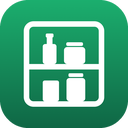
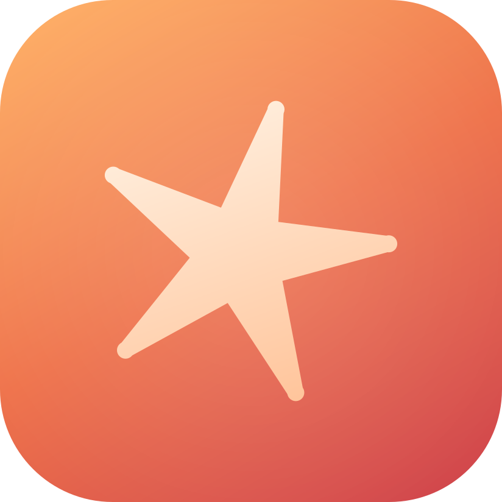
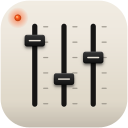
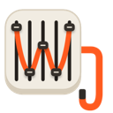
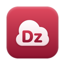
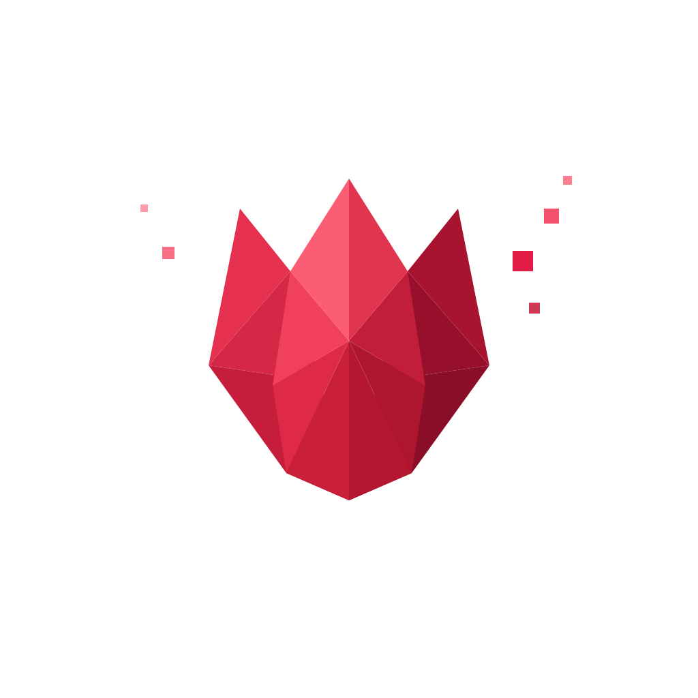

Hi, I'm Zolfer, a mobile developer. I build iOS and Android apps with React Native and TypeScript: 7+ years in React Native, 17+ years in software. My first program was an mIRC script that mapped hotkeys to funny messages, and I still write code for fun: below are the apps I've built and shipped myself.

Before mobile, I spent ten years in full-stack and team-lead roles in Brazil, building ERPs, e-commerce and web platforms.

### What I've shipped

<table>
<tr>
<td width="56" valign="top"></td>
<td colspan="3"><b><a href="https://appdespensado.zolfer.com">Despensado</a></b> · iOS and Android · <a href="https://apps.apple.com/us/app/despensado/id6806343938">App Store</a> · <a href="https://play.google.com/store/apps/details?id=com.zolfer.despensado">Google Play</a>
 Scan groceries by barcode, get warned before anything expires, share one pantry with your household. In 12 languages.</td>
</tr>
<tr>
<td width="56" valign="top"></td>
<td colspan="3"><b><a href="https://app.claudiostat.zolfer.com">ClaudioStat App</a></b> · iOS, watchOS, Android and Wear OS Your Claude plan limits on your phone, your watch and their widgets. No computer needed.</td>
</tr>
<tr>
<td width="56" valign="top"></td>
<td colspan="2"><b><a href="https://claudiostat.zolfer.com">ClaudioStat</a></b> · macOS Your Claude plan limits, live in the menu bar. A refresh costs zero tokens.</td>
<td nowrap valign="top">Open source <a href="https://github.com/zolferfigueiredo/claudiostat">GitHub</a></td>
</tr>
<tr>
<td width="56" valign="top"></td>
<td colspan="2"><b><a href="https://github.com/zolferfigueiredo/modclaudiostat">ClaudioStat Mod</a></b> · Claude desktop app Your session, week and Fable limits with pace and budget, in a thin row above the prompt.</td>
<td nowrap valign="top">Open source <a href="https://github.com/zolferfigueiredo/modclaudiostat">GitHub</a></td>
</tr>
<tr>
<td width="56" valign="top"></td>
<td colspan="2"><b><a href="https://bhb.zolfer.com">BeeHan Brightness</a></b> · macOS 16 brightness steps below the lowest one macOS allows, on the same keys, with the native HUD.</td>
<td nowrap valign="top">Open source <a href="https://github.com/zolferfigueiredo/bhbrightness">GitHub</a></td>
</tr>
<tr>
<td width="56" valign="top"></td>
<td colspan="2"><b><a href="https://tallynn.zolfer.com">Tallynn</a></b> · macOS Your GitHub release downloads, live in the menu bar, with a notification the moment any of them changes.</td>
<td nowrap valign="top">Open source <a href="https://github.com/zolferfigueiredo/tallynn">GitHub</a></td>
</tr>
<tr>
<td width="56" valign="top"></td>
<td><b><a href="https://theej.zolfer.com">TheeJ</a></b> · macOS Real knobs for your Mac: a deej Arduino mixer for volume, display brightness and keyboard backlight.</td>
<td nowrap valign="top">Inspired by <a href="https://github.com/omriharel/deej">deej</a></td>
<td nowrap valign="top">Open source <a href="https://github.com/zolferfigueiredo/theej">GitHub</a></td>
</tr>
<tr>
<td width="56" valign="top"></td>
<td><b><a href="https://weej.zolfer.com">WeeJ</a></b> · Windows Real knobs for your PC: the Windows client for a deej mixer. Each knob sets a volume, a screen's brightness, Night light or a keyboard backlight.</td>
<td nowrap valign="top">Inspired by <a href="https://github.com/omriharel/deej">deej</a></td>
<td nowrap valign="top">Open source <a href="https://github.com/zolferfigueiredo/weej">GitHub</a></td>
</tr>
<tr>
<td width="56" valign="top"></td>
<td><b><a href="https://wrecktangle.zolfer.com">Wrecktangle</a></b> · Windows A Rectangle-style window manager. Snap the focused window to a half, a corner or the center with one shortcut.</td>
<td nowrap valign="top">Inspired by <a href="https://rectangleapp.com">Rectangle</a></td>
<td nowrap valign="top">Open source <a href="https://github.com/zolferfigueiredo/wrecktangle">GitHub</a></td>
</tr>
<tr>
<td width="56" valign="top"><a href="https://url.zolfer.com"><picture><source media="(prefers-color-scheme: dark)" srcset="https://raw.githubusercontent.com/zolferfigueiredo/zolferfigueiredo/main/assets/project-url.svg"></picture></a></td>
<td colspan="3"><b><a href="https://url.zolfer.com">url.zolfer.com</a></b> · Web Paste a long link, get a short one and a QR code.</td>
</tr>
<tr>
<td width="56" valign="top"></td>
<td colspan="3"><b><a href="https://zolfer.com">zolfer.com</a></b> · Web My pixel-art portfolio, designed by <a href="https://www.behance.net/charlenedalmolin">Charlene Dal Molin</a>.</td>
</tr>
</table>

### Coming soon

<table>
<tr>
<td width="56" valign="top"></td>
<td><b><a href="https://scutae.zolfer.com">scutæ</a></b> · Web and macOS Split any song into six stems, then mute your part in a browser mixer and play along with the band.</td>
</tr>
<tr>
<td width="56" valign="top"></td>
<td><b><a href="https://deploydz.zolfer.com">Deploydz</a></b> · macOS Merge to main and it's live: runs your self-hosted GitHub Actions runners and shows every deploy and release in the menu bar.</td>
</tr>
<tr>
<td width="56" valign="top"></td>
<td><b><a href="https://appcelia.zolfer.com/?lang=en">Celia</a></b> · iOS and Android Care for someone you love, organized in one place: medicines, appointments, doctors and health measurements, shared with your family.</td>
</tr>
<tr>
<td width="56" valign="top"></td>
<td><b><a href="https://myfood.lv">myfood.lv</a></b> · Web Local food straight from Latvian farmers. A partner project.</td>
</tr>
</table>

Day to day: React Native, TypeScript, Expo, Node.js, GraphQL and MySQL.

[zolfer.com](https://zolfer.com) · [LinkedIn](https://www.linkedin.com/in/zolfer/)
